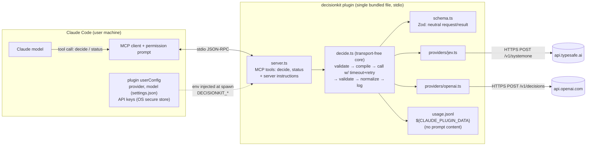

# decisionkit — Architecture (v1 proposal)

> Working name `decisionkit` (free on npm as of 2026-10-10; it must not contain "claude" per the plugin name validator). Status: **proposal, awaiting approval. No implementation yet.**
> All facts below were verified on **2026-10-10** unless marked UNVERIFIED.

## 0. Build status (2026‑10‑10)

Built per this design: `src/` (schema, Jev + OpenAI adapters, `decide.ts`, `server.ts`), plugin manifests, the npm bundle, tests, CI, the README and the benchmark harness.

**Verified locally:**
- **Tests:** 21 pass. They cover schema validation, both adapters against the doc fixtures, retries and timeouts, the config rules, and stdio end‑to‑end against a mock provider.
- **Packaging:**
  - `claude plugin validate --strict` passes.
  - The `npm pack` tarball installs, and the end‑to‑end test passes through the installed bin.
  - The bundle starts and answers on Node 20, 22 and 24.
- **Plugin spike** (isolated `CLAUDE_CONFIG_DIR`; the real config was confirmed unchanged by hash):
  - The CLI install does **not** prompt for settings. The user runs `/plugin configure` or passes `--config K=V`.
  - Unset values arrive as `""` and defaults are substituted (R1 resolved).
  - `CLAUDE_PLUGIN_DATA` is provided.
  - Uninstall deletes the data dir and `pluginConfigs`.
- **Inside real Claude Code (2026‑10‑10):** installed from github.com/adityajha2005/decisionkit. Headless Claude Code (Haiku), with only the two plugin tools allowlisted as `mcp__plugin_decisionkit_decisionkit__{decide,status}`, called `status` (ping 200), then `decide` against live OpenAI. The call took 562 ms on 1 attempt, used 396 input tokens, produced no permission denials, and logged a usage record.
- **Baseline:** Claude Haiku 5.5 (`claude-haiku-5-5`, confirmed from `modelUsage`) via an isolated `claude -p` got 18/20 (90%, 95% CI 70–99), against 19/20 for OpenAI Decisions; the intervals fully overlap. Haiku cost about $0.004 in total versus $0.0005, and returned no probabilities. Haiku's ~3.7 s p50 includes CLI process start‑up, so latency is not a like‑for‑like comparison.
- **Real model (mock provider):** headless Claude Code (Haiku), with the server attached through `--mcp-config` and a mock provider behind it, found the deferred tool, formed a valid call (choice + binary with criteria), and reported the result with the calibration caveat.

**Not yet verified:**
- **Jev live via OpenRouter (2026‑10‑10):** `~typesafe/jev-latest` resolved to `typesafe/jev-1.13-20260917`. 20/20 responses passed the response checks. 18/20 correct (90%, CI 70–97), Brier 0.042, p50 514 ms, $0.00033 total from OpenRouter‑reported `usage.cost`. Misses: brk‑5 (ambiguous label) and sev‑3. Direct `api.typesafe.ai` is untested, because no TypeSafe key was available.
- **Live provider calls: OpenAI verified 2026‑10‑10.** On OpenAI (`gpt-6-luna`), the 20‑task seed benchmark had 0 errors and 19/20 correct (95%, 95% CI 76–99). p50 latency was 219 ms, with a 4.7 s cold first call. Total estimated cost was $0.0005. The one miss (brk‑5) looks like an ambiguous label rather than a model error. n is small and the tasks are author‑written, so this is **not** a quality claim.
- **Secure store on Linux** (R3). On macOS it is verified: installing from GitHub with `--config openai_api_key=…` kept the key out of `settings.json`, and the server received it. Whether uninstall clears the Keychain entry is still unverified.
- **Other clients:** Codex, Cursor and VS Code smoke tests were not run. The `decide` input schema emits a 4‑variant `oneOf`, and whether every client handles it is unverified.
- **Benchmark:** done. 100 blind-checked tasks (v2) plus the 20 seed tasks, run on OpenAI Decisions, Jev via OpenRouter, Haiku 5.5 direct and Haiku 5.5 via `claude -p`. See `bench/RESULTS.md`.

---

## 1. Executive summary

`decisionkit` is a **Claude Code plugin** that bundles one stdio **MCP server**. It exposes a provider‑neutral `decide` tool backed by either **Jev (TypeSafe AI)** or the **OpenAI Decisions API**.

**Key finding: the two providers are close to isomorphic.** Both take *text context + typed questions* and return *typed answers with probability distributions*. Both offer the same three question types:

| Neutral type | Jev | OpenAI |
|---|---|---|
| `binary` | `noul` | `predicate` |
| `choice` | `choice` | `choice` |
| `score` (ordered levels, 0‑based) | `score` | `score` |

Neither provider returns a rationale. Neither has a native ranking primitive.

This lets the neutral schema be a **thin, lossless intersection** rather than a lowest‑common‑denominator abstraction.

The architecture is deliberately small:

- **Distribution is a Claude Code plugin, not an npm installer.** The plugin system already provides several things natively:
  - Install, uninstall and enable/disable.
  - Masked secret prompts stored in the OS secure store (`userConfig.sensitive`).
  - A `/config` UI.
  - Namespaced tool names, which prevent duplicates.
  - A plugin data directory that is cleaned up on uninstall.

  Writing our own config‑file mutator would re‑implement all of this, worse.
- **No CLI in v1.** The planned commands map onto existing mechanisms:

  | Planned command | v1 equivalent |
  |---|---|
  | `init` | `claude plugin install` |
  | `config` | `/config` |
  | `uninstall` | `claude plugin uninstall` |
  | `doctor` + `stats` | A second MCP tool, `status`, which can see the injected credentials (a Bash‑run CLI could not) |

- **Works outside Claude Code too.** The same bundled server is also published to npm (`decisionkit`), so any MCP client can use it with whatever model the user prefers: Codex CLI, Cursor, VS Code / Copilot, Gemini CLI, Claude Desktop, Windsurf, Zed. There are no extra source files. §9.1 covers the per‑client setup and the secret‑handling gotchas.
- **No HTTP server.** No consumer needs one. The core `decide()` function is transport‑free, so an HTTP wrapper is about 30 lines later.
- **Native `fetch` + Zod** instead of the two official SDKs. The reasons are in §6.4.
- **Explicit delegation only.** Claude decides when to call the tool, guided by server instructions. Nothing intercepts Claude's reasoning; §7 explains what hooks can and cannot do.
- **No cost, accuracy or token‑saving claims.** §10 defines the benchmark that would have to justify any such claim.

### 1.1 Design choices and the simpler alternatives considered

| Choice | Why | Simpler / other alternative | Why not (yet) |
|---|---|---|---|
| Claude Code plugin for distribution | Install, uninstall, secret prompts and the secure store come built in (§9) | npm package + `npx … init` editing `~/.claude.json` | We would have to write a config merger, backups and rollback ourselves, and the key would sit in plaintext |
| MCP tool as the integration point | It is the only callable, schema‑validated action (§7.1) | A skill that teaches Claude to `curl` the API | The key would be exposed to the Bash tool, with no validation or typed errors |
| `status` tool in place of a CLI | It can see the injected credentials; no extra entry point | `doctor` / `stats` CLI commands | A CLI run from Bash can't see plugin secrets, and it is another binary to ship |
| Server instructions in place of a skill | Always loaded, even when tool schemas are deferred | Skill with delegation rules | It duplicates the instructions. Add one only if the eval shows under‑use. |
| No hooks | Hooks can't force delegation, and automatic hooks would send every prompt to a third party | `UserPromptSubmit` → `mcp_tool` hook | That is a privacy and cost problem. It belongs behind an explicit opt‑in later. |
| Native `fetch` + Zod | One code path for timeout, retry and errors; easy to mock (§6.4) | Official SDKs | Two different retry policies; a beta/0.x API surface. Can be swapped in later per adapter. |
| Zod for validation | Required peer dependency of the MCP SDK already; one schema yields types, validation and the tool's JSON Schema | Hand‑written type guards / raw JSON Schema + ajv | Guards drift from the types; ajv would be an extra dependency |
| MCP TS SDK v2 (`@modelcontextprotocol/server`) | The current stable line; v1 is security‑fix‑only | `@modelcontextprotocol/sdk` v1 | It is on the legacy track; we would migrate within months |
| esbuild single‑file bundle | Plugin installs run no `npm install` | Vendoring `node_modules` | Thousands of files in git, plus platform risk |
| `node:test` | Built into Node 24 with TypeScript stripping; no dependency | vitest / jest | A dependency with no benefit at this size |
| JSONL usage log + `status` | Append‑only, greppable, deleted on uninstall | SQLite / a dashboard | No query need justifies them |
| No HTTP server | No non‑MCP consumer exists | Express/Fastify API | `decide()` is transport‑free, so adding HTTP later is a thin wrapper |
| No fallback provider | Both providers are paid, so a fallback means silent extra billing | Automatic failover | It would violate "never silently fall back to a paid provider" |
| Same bundle on npm for other MCP clients | One artifact serves every client; users keep their own model | A separate package or SDK per client | Every client already speaks MCP over stdio, so per‑client packages add nothing |
| README snippets + install links for other clients | Each client has its own config format; Cursor and VS Code support one‑click install links | `npx decisionkit init --client <x>` that writes 6 config formats | Six config writers, each needing backup and rollback. Add if users ask. |
| Delegation rules repeated in the `decide` tool description | Tool descriptions reach every client; server `instructions` are documented only in Claude Code, Codex, VS Code and Gemini CLI | Server instructions only | Cursor, Zed and Windsurf users would get no delegation or privacy rules |

---

## 2. Documentation and API verification report (verified 2026‑10‑10)

### 2.1 Jev by TypeSafe AI — VERIFIED (primary docs)

| Item | Finding | Source |
|---|---|---|
| Product | "Jev is TypeSafe's flagship model and the first System One model. Send state and typed questions; get structured answers…" | https://docs.typesafe.ai/introduction.md |
| Endpoint | `POST https://api.typesafe.ai/v1/systemone` | https://docs.typesafe.ai/api.md |
| Models endpoint | `GET https://api.typesafe.ai/v1/models` → `{models:[{name,description,release_date}]}` | https://docs.typesafe.ai/models.md |
| Auth | `Authorization: Bearer <API_KEY>`. Keys come from console.typesafe.ai/keys. Key format is UNVERIFIED. | api.md |
| Request | `state` (string \| object \| array, required); `model` (`jev-latest` \| `jev-preview` \| `jev-1.13.0`); `questions` (map id → `{type, instructions, criteria}`) | api.md |
| Types | `noul` (criteria optional `{true,false}`); `choice` (criteria map option→description, max **255**); `score` (criteria = array of level descriptions, **2–10**) | api.md |
| Response | `{model, answers:{<id>:…}, usage:{input_tokens, output_tokens}}`. `noul → {noul: 0..1}` with no confidence. `choice → {choice, probabilities (sum 1), confidence}`. `score → {score (prob‑weighted, 0‑based), legend, probabilities, confidence}` | api.md |
| Confidence | Derived from the probabilities. For choice: `(p_max − 1/n)/(1 − 1/n)`. Calibration is *claimed* via "RLCD"; no published ECE was found. | https://docs.typesafe.ai/confidence.md |
| Rationale | **None** | api.md |
| Errors | 401 auth, 422 validation, 429 rate limit, 529 overloaded | api.md |
| Limits | 80 req/s and 100K tok/s, "adjusting dynamically… can change without notice". 64k context; 32k for state + longest question. Text only. | models.md |
| Pricing | $0.042 per 1M input tokens; output tokens free | models.md |
| SDKs | `@typesafe-ai/sdk` 0.6.0 (npm, MIT, `client.systemOne()`); `typesafe-sdk` 0.7.4 (PyPI) | npm registry, https://docs.typesafe.ai/sdk/javascript.md |
| Claude Code integration | Official agent‑skill plugin `typesafe-ai/skills`. It gives the agent API context only; **no MCP server, no tools**. | https://github.com/typesafe-ai/skills, https://docs.typesafe.ai/agent-skill.md |
| Ecosystem | About 10 community `typesafe-mcp` repos, created 2026‑09‑20 to 10‑09 | `gh search repos "typesafe mcp"` |
| UNVERIFIED | Free tier; whether a waitlist still applies; key prefix; quantitative calibration evidence | — |

### 2.2 OpenAI Decisions API — VERIFIED (public beta)

| Item | Finding | Source |
|---|---|---|
| Status | Beta, released 2026‑10‑06: "The Decisions API is in public beta, and we expect to GA in the coming weeks." No allowlist stated. | https://developers.openai.com/api/docs/guides/decisions, https://developers.openai.com/api/docs/changelog |
| Endpoint | `POST https://api.openai.com/v1/decisions`, `Authorization: Bearer $OPENAI_API_KEY` | guide |
| Model | `gpt-6-luna` — "the only model currently available" | guide, https://developers.openai.com/api/docs/models/gpt-6-luna |
| Request | `model`; `input` (string, or user messages with `input_text` / `input_image` as base64 data URLs only); `questions[]`; `safety_identifier?` | guide, openai-node `src/resources/decisions.ts` |
| Types | `predicate {instructions}`; `choice {instructions, choices:[{value, description?}]}`; `score {instructions, levels:[{label, description?}]}`, ordered low→high. Each type takes an optional `name`. | guide |
| Response | `{answers:[…] (in question order), model, usage:{input_tokens, output_tokens, …details}}`. `predicate → {probability}`. `choice → {choice, probabilities:[{value,probability}], confidence}`. `score → {score, probabilities:[{value,label,probability}], confidence}`. `refusal → {name}` | guide, SDK |
| Semantics | `probability` = "an estimate from 0 to 1 that the condition is true". `score` = "the probability‑weighted average of the level indices". **`confidence` is undocumented.** No calibration claim; the guide says to "Use labeled examples from your application to set thresholds". | guide |
| Rationale | **None.** The guide points to Responses + Structured Outputs for explanations. | guide |
| Pricing | $0.10 per 1M input tokens; "no cache‑read, cache‑write, or output‑token charges". Regional and long‑context multipliers apply. | guide |
| SDK | `openai` ≥ 7.30.0 → `client.decisions.create()`. The current version is 7.31.0. | openai‑node CHANGELOG, npm |
| UNVERIFIED | Endpoint‑specific rate limits; maximum questions, choices and levels; meaning of `confidence`; refusal triggers; a dedicated API‑reference page (it returned 404) | — |

### 2.3 Capability compatibility (what actually differs)

| Dimension | Jev | OpenAI | Design consequence |
|---|---|---|---|
| Auth | Bearer key | Bearer key | One `apiKey` per provider |
| Context | string \| object \| array | string \| user messages (+ images) | v1: **string only** (images deferred; Jev is text‑only) |
| Questions container | map keyed by id | ordered array with optional `name` | Adapter converts; we always key by id |
| Binary criteria | native `{true,false}` | none | OpenAI: criteria are **folded into the instructions text** (documented as emulated) |
| Choice limit | 255 | UNVERIFIED | Global cap 255 |
| Score levels | 2–10, descriptions only | `{label, description}` | Global cap 2–10; Jev receives `"label: description"` |
| Probabilities | map | array | Normalized to a `{value: p}` map |
| `confidence` | documented formula | undocumented | Kept **only** under `native`, never normalized |
| Refusal | not documented | `refusal` answer type | Becomes a non‑success result (`isError`) |
| Usage | `input_tokens`, `output_tokens` | plus cache and reasoning details | Normalize the two common fields; the rest is dropped from logs |
| Calibration | claimed | not claimed | Neither is called "calibrated"; the benchmark measures it |

### 2.4 Claude Code — VERIFIED (installed: v2.1.296)

| Fact | Source |
|---|---|
| `claude mcp add [--scope local\|project\|user] [-e K=V] <name> -- <cmd>`. Local and user scopes are stored in `~/.claude.json`; project scope in `.mcp.json`. `${VAR}` expansion works in `.mcp.json`. | https://code.claude.com/docs/en/mcp.md |
| MCP tools are **deferred by default** (tool search): only names and server instructions load up front. Server instructions and tool descriptions are truncated at 2,048 chars. `alwaysLoad: true` opts out. | mcp.md |
| `MCP_TOOL_TIMEOUT` defaults to about 28h, so **we must enforce our own timeout**. Output warns above 10k tokens; the max is 25k. | mcp.md |
| Plugin layout: `.claude-plugin/plugin.json`, `.mcp.json` at the root, `skills/`, `hooks/hooks.json`. `${CLAUDE_PLUGIN_ROOT}` (changes on update) and `${CLAUDE_PLUGIN_DATA}` (kept across updates, deleted on uninstall). | https://code.claude.com/docs/en/plugins/manifest-reference.md |
| `userConfig` fields: `type`, `title`, `description`, `required`, `default`, `options`, `sensitive`. Users are prompted **when the plugin is enabled**. `sensitive` values go to the **platform secure store**; others go to `settings.json` `pluginConfigs` and appear in `/config`. `${user_config.KEY}` substitutes into the MCP server `env`. | manifest-reference.md |
| Plugin MCP tool names are `mcp__plugin_<plugin>_<server>__<tool>`. Permission rules use `mcp__<server>__<tool>`; `mcp__*` allow globs are rejected. | mcp.md, https://code.claude.com/docs/en/permissions.md |
| Plugin npm sources run no install scripts. **Ship a self‑contained bundle.** | https://code.claude.com/docs/en/plugins/install.md |
| Hooks can block or allow tools, rewrite tool input/output, and inject `additionalContext` (≤10k chars). `mcp_tool` hooks can call an MCP tool directly. Hooks **cannot** modify model reasoning or force the model to delegate. | https://code.claude.com/docs/en/hooks.md |
| MCP spec: `structuredContent` + `outputSchema` exist, and the result SHOULD also carry the JSON as text. Tool failures use `isError: true`. **Claude Code's handling of `structuredContent` is UNVERIFIED**, so we always return text JSON. | https://modelcontextprotocol.io/specification/2025-06-18/server/tools |
| MCP TS SDK v2: `@modelcontextprotocol/server` 2.3.1 (`McpServer`, `registerTool`, `StdioServerTransport` from `/stdio`). Zod v4 is a peer dependency. v1 `@modelcontextprotocol/sdk` 1.32.1 is legacy. | https://github.com/modelcontextprotocol/typescript-sdk, npm |

---

## 3. Architecture diagram



The five concerns live in separate places:

| Concern | Where it lives |
|---|---|
| Claude Code integration | `server.ts` and the plugin manifest |
| Schemas | `schema.ts` |
| Provider adapters | `providers/*` |
| Configuration and secrets | plugin `userConfig` → env → `config()` in `decide.ts` |
| Observability | stderr logs + `usage.jsonl`, written by `decide.ts` |

## 4. Request lifecycle

```mermaid
sequenceDiagram
  autonumber
  participant U as Developer
  participant C as Claude (model)
  participant CC as Claude Code
  participant S as decisionkit MCP server
  participant A as Provider adapter
  participant API as Jev / OpenAI API

  C->>CC: tool_use decide{context, questions}
  CC->>U: permission prompt (shows payload + tool name)
  U-->>CC: allow
  CC->>S: tools/call decide
  S->>S: Zod-validate request, load config (provider required)
  alt invalid request / missing key
    S-->>CC: isError: true {kind: invalid_request | config}
  else valid
    S->>A: compile (neutral → provider body), rank → N score questions
    loop attempt ≤ 3 within deadline (default 15s, AbortController)
      A->>API: POST (Bearer key)
      API-->>A: 2xx | 401 | 422 | 429 | 529 | 5xx
      Note over A: retry only 429 (not insufficient_quota), 529, 500/502/503/504, network; honor Retry-After
    end
    A->>A: Zod-validate provider response; check choice ∈ options, p ∈ [0,1], Σp≈1
    A-->>S: normalized answers | typed error
    S->>S: append usage.jsonl (ids, provider, model, latency, tokens, est. cost, status)
    S-->>CC: content[text: JSON] (+ structuredContent), isError if failed/refused
  end
  CC-->>C: tool result (names provider + model + request_id)
```

---

## 5. Repository structure

```
decisionkit/
├── .claude-plugin/
│   ├── plugin.json        # manifest: userConfig, mcpServers, one command (/decisionkit:status)
│   └── marketplace.json   # single-plugin marketplace, source "./" → `claude plugin marketplace add adityajha2005/decisionkit`
├── src/
│   ├── schema.ts          # Zod: neutral request, answers, result, error kinds
│   ├── providers/
│   │   ├── jev.ts         # compile(req) → body, parse(json) → answers, mapError(status, body)
│   │   └── openai.ts
│   ├── decide.ts          # config(), decide(req, {fetch, now}) — timeout, retry, rank fan-out, usage log, price table
│   └── server.ts          # McpServer + StdioServerTransport; tools: decide, status; server instructions
├── dist/server.mjs        # esbuild single-file bundle (committed; CI fails if stale)
├── test/                  # node:test, fixtures copied verbatim from provider docs
├── bench/
│   ├── tasks.jsonl        # labeled tasks
│   └── run.ts
├── docs/ARCHITECTURE.md
├── package.json           # "bin": {"decisionkit": "dist/server.mjs"}, "files": ["dist"]. deps bundled, so the npm package has 0 runtime deps.
│                          # devDeps: esbuild, typescript, @types/node, @modelcontextprotocol/server, @modelcontextprotocol/client, zod
└── README.md              # install, data disclosure, uninstall, Windows note
```

That is 5 source files and 2 runtime dependencies. No `src/index.ts`, no factory, no `cli.ts`.

*Alternative considered:* a monorepo with `core` / `mcp` / `cli` packages. It is rejected because there is one consumer today. The `decide()` boundary gives the same seam without package overhead.

---

## 6. Provider interface and normalized schema

### 6.1 Request (neutral)

```ts
type DecideRequest = {
  context: string;                    // → Jev `state`, OpenAI `input`. Text only in v1.
  questions: Question[];              // 1..16 (our cap), ids unique, ^[a-z0-9_]{1,40}$
  tag?: string;                       // local log label only. NEVER sent to the provider.
};

type Question =
  | { id: string; type: "binary"; instructions: string;
      criteria?: { true?: string; false?: string } }           // Jev native; OpenAI: appended to instructions
  | { id: string; type: "choice"; instructions: string;
      options: { value: string; description?: string }[] }     // 2..255, unique values
  | { id: string; type: "score"; instructions: string;
      levels: { label: string; description?: string }[] }     // 2..10, ordered low → high
  | { id: string; type: "rank"; instructions: string;          // DERIVED: N score questions in one request
      candidates: { id: string; text: string }[];              // 2..20
      levels?: { label: string; description?: string }[] };    // default 5-level relevance rubric
```

The design deliberately leaves out several fields the original prompt suggested:

- **No `constraints` field.** Neither API has one. Constraints belong in `instructions`, which is where both providers read them. A separate field would be concatenated into the instructions anyway and would imply semantics that don't exist.
- **No `decision_type` field.** The question `type` *is* the decision type.
- **No `metadata` sent upstream.** `tag` exists only for local stats.
- **No per‑call `provider` override.** The provider is chosen in configuration, once, visibly.

### 6.2 Result (neutral)

```ts
type DecideResult =
  | { ok: true; provider: "jev" | "openai"; model: string;   // model string as RETURNED by the provider
      request_id: string; latency_ms: number; attempts: number;
      usage: { input_tokens: number; output_tokens?: number };
      estimated_cost_usd: number | null;                     // from dated price table; lower bound for OpenAI
      answers: Record<string, Answer>;
      notes: string[] }                                      // e.g. "probabilities are provider estimates, not verified calibrated"
  | { ok: false; provider: "jev" | "openai" | null; request_id: string;
      error: { kind: ErrorKind; status?: number; message: string; retryable: boolean };
      answers?: Record<string, Answer> };                    // partial answers only when kind = "refused"

type Answer =
  | { type: "binary"; probability_true: number }
  | { type: "choice"; choice: string; probabilities: Record<string, number>;
      native: { confidence?: number } }
  | { type: "score"; expected_level: number;                 // 0-based, may fall between levels
      most_likely: string; probabilities: Record<string, number>;   // keyed by level label
      native: { confidence?: number } }
  | { type: "rank"; derived: true;
      ranking: { candidate_id: string; expected_level: number }[] }  // sorted desc
  | { type: "refused" };

type ErrorKind = "config" | "invalid_request" | "auth" | "rate_limited" | "quota"
  | "overloaded" | "timeout" | "network" | "provider_response_invalid" | "refused";
```

**Normalization rules:**

- **Normalize only where the meaning is identical:**
  - The selected choice.
  - The probability distributions: both providers return per‑option probabilities that sum to 1, as a map on Jev and an array on OpenAI.
  - `expected_level`: both providers document it as a probability‑weighted, 0‑based index.
- **`confidence` stays under `native`.** Jev defines it as a function of the distribution. OpenAI doesn't define it. Normalizing the two would merge different quantities.
- **Binary answers have no `decision` field.** Choosing a threshold is the caller's job, and both providers say so in effect. Claude gets `probability_true` and applies a threshold appropriate to the cost of errors.
- **No `rationale` field at all.** Neither provider returns one. An empty or synthesized rationale would be fabrication.
- **`rank` is labeled `derived: true`.** Its `expected_level` values come from independent score questions over shared context. They are not guaranteed to be comparable across candidates, and they multiply input tokens roughly by N. The tool description says this.
- **`notes` always include** the provider name and the line "Probabilities are the provider's estimates; they have not been verified as calibrated for your task."

### 6.3 Handling unsupported capabilities

- **Our own validation caps use the stricter provider's documented limits.** These are Jev's: choice ≤255, levels 2–10. Our validation therefore accepts or rejects the same requests whichever provider is selected. OpenAI's own limits on choices, levels, questions and context are UNVERIFIED, so OpenAI may still reject a request Jev accepts. That case surfaces as `invalid_request` from the provider.
- **Rejected with `invalid_request`, never silently degraded:** images, non‑string context, and over‑cap lists.
- **Emulated features are named in `notes`.** Example: `binary.criteria` on OpenAI is folded into the instructions text.
- **Provider‑side refusal** returns `ok:false, kind:"refused"`. Any answers that did come back are attached for transparency, but the call is an error.
- **Invalid provider responses** are rejected with `provider_response_invalid` and never passed through. This covers:
  - A schema mismatch.
  - `choice` not among the supplied options.
  - A probability outside [0,1].
  - |Σp − 1| > 0.02.

### 6.4 Provider adapter contract

```ts
type Adapter = {
  name: "jev" | "openai";
  url: string;
  compile(q: CompiledQuestion[], context: string, model: string): unknown;     // HTTP body
  parse(json: unknown, q: CompiledQuestion[]): Record<string, Answer>;         // throws ProviderResponseInvalid
  classify(status: number, body: unknown): { kind: ErrorKind; retryable: boolean };
};
```

Adapters are pure data mappers. All I/O (fetch, timeout, retry, logging) sits once in `decide.ts`.

**Native `fetch` instead of the official SDKs:**

- Each provider needs only one endpoint.
- Timeout, retry and error mapping must behave identically across providers. The SDKs each have their own retry defaults, which would double‑retry and double‑bill unless they are disabled.
- Tests inject `fetch`, which satisfies "mocked HTTP" with no extra libraries.
- The OpenAI Decisions resource is 4 days old and in beta. The Jev JS SDK is 0.x. Pinning their wire formats in our own Zod schemas makes any drift fail loudly in one place.

*Alternative considered:* the official SDKs with `maxRetries: 0`. This is acceptable and can be swapped in later, since the change stays inside one adapter.

---

## 7. Claude Code integration

### 7.1 Mechanism choice

| Mechanism | Role in v1 | Why |
|---|---|---|
| **MCP tool (`decide`)** | **Primary** | It is the only mechanism that gives Claude a callable, schema‑validated action |
| **MCP tool (`status`)** | Diagnostics and stats | It runs inside the server process, so it can see the injected credentials (as present/absent only) and the usage log |
| **Server instructions** | Delegation rules | They are always loaded, even when tool schemas are deferred. The limit is 2,048 chars. |
| `decide` tool description | Short delegation rules: closed answer set, no secrets, report errors, don't invent answers | The one place every MCP client is guaranteed to show the model. It stays well under Codex's 512‑character standalone guidance for instructions. |
| Plugin command `/decisionkit:status` | Convenience | A one‑line inline command that asks Claude to call `status` |
| Skill | **Not in v1** | Server instructions already carry the rules. Add a skill only if the benchmark shows Claude under‑uses the tool. |
| Hooks | **Not in v1** | See below |

**What hooks could do, and why v1 doesn't use them:**

- An `mcp_tool` hook on `UserPromptSubmit` could call `decide` automatically on every prompt, for example to classify it, and inject the result as `additionalContext`.
- That is genuinely automatic. It is also what we must not do by default: it would ship every prompt to a third party and bill for it.
- If ever added, it must be a separate, opt‑in, clearly documented hook.

**What no mechanism can do:** hooks cannot alter Claude's reasoning or make Claude delegate a decision. Every delegation in v1 is an **explicit tool call that Claude chooses to make**, visible to and approvable by the developer.

### 7.2 Server instructions (draft, < 2,048 chars)

```
decisionkit sends a text context plus typed questions to an EXTERNAL decision API
(provider and model are named in every result) and returns probabilities.

Use `decide` when ALL hold:
- the answer is from a closed set: yes/no (binary), one of listed options (choice),
  an ordered rubric (score), or an ordering of listed candidates (rank);
- everything needed fits in `context` as text you write into the call;
- it is a judgment over text (classify, route, triage, grade, rank), not computation,
  code generation, or fact lookup;
- a probability is useful (e.g. to flag low-certainty cases) or the user asked for it.

Do NOT use it when:
- the context would include secrets, credentials, personal data, or code the user has
  not cleared for sending to this third party;
- the answer is deterministic (a test, regex, or type check decides it);
- a wrong answer has side effects and no human will review it.

Rules:
- Put constraints in `instructions`. There is no rationale in results; do not invent one.
- Probabilities are provider estimates, not verified calibrated. Choose thresholds by the
  cost of mistakes; report uncertainty to the user.
- If the result has isError, report the error. Never substitute your own answer as if it
  came from the tool.
- `rank` is derived from independent scores; treat close values as ties.
```

### 7.3 Example: classifying a task (choice + binary)

Call (Claude → `decide`):

```json
{
  "context": "Issue #412: Clicking 'Export CSV' on /reports returns HTTP 500 since v2.3. Trace ends in csv_writer.py:88 (KeyError 'tz').",
  "questions": [
    { "id": "kind", "type": "choice", "instructions": "What kind of work item is this?",
      "options": [
        { "value": "bug", "description": "Existing behavior is broken" },
        { "value": "feature", "description": "New capability" },
        { "value": "refactor", "description": "Internal change, same behavior" },
        { "value": "docs" } ] },
    { "id": "needs_migration", "type": "binary",
      "instructions": "Does fixing this likely require a database schema migration?" }
  ]
}
```

Result shape (**the numbers are illustrative, not real output**):

```json
{ "ok": true, "provider": "jev", "model": "jev-1.13.0", "request_id": "dk_01J…",
  "latency_ms": 212, "attempts": 1, "usage": { "input_tokens": 141, "output_tokens": 9 },
  "estimated_cost_usd": 0.0000059,
  "answers": {
    "kind": { "type": "choice", "choice": "bug",
              "probabilities": { "bug": 0.94, "feature": 0.01, "refactor": 0.04, "docs": 0.01 },
              "native": { "confidence": 0.92 } },
    "needs_migration": { "type": "binary", "probability_true": 0.07 } },
  "notes": ["Sent to jev (TypeSafe AI).", "Probabilities are the provider's estimates; they have not been verified as calibrated for your task."] }
```

A ranking call uses `{"type":"rank","candidates":[{"id":"a","text":"…"}, …]}`. A binary‑only call is just one `binary` question.

### 7.4 Limits to state plainly in the README

- **Claude decides when to call the tool.** Expect both missed opportunities and unnecessary calls. The benchmark (§10.3) measures this.
- **Tool schemas are deferred** until Claude searches for them. Users who want the tool always visible can set `alwaysLoad`, which costs context tokens.
- **No token‑saving claim.** Claude must *write* the context into the tool call, which costs Claude output tokens. Net effect is measured, not assumed.

---

## 8. Configuration and secrets

### 8.1 Plugin `userConfig` (set with `/plugin configure` or `claude plugin install --config K=V`; non‑sensitive values editable in `/config`)

| Key | Type | Notes |
|---|---|---|
| `provider` | string, `options: ["jev","openai"]`, **required, no default** | No implicit provider means no surprise billing |
| `typesafe_api_key` | string, **sensitive** | OS secure store |
| `openai_api_key` | string, **sensitive** | OS secure store |
| `model` | string, optional | Default `jev-latest` / `gpt-6-luna`. Pin `jev-1.13.0` for reproducible benchmarks. |
| `timeout_ms` | number, 1000–60000, default 15000 | Total deadline across retries |
| `usage_log` | boolean, default true | Writes `usage.jsonl` (no prompt content) |

The plugin's `.mcp.json` maps these into **namespaced** env vars:

```json
{ "decisionkit": { "command": "node", "args": ["${CLAUDE_PLUGIN_ROOT}/dist/server.mjs"],
    "env": { "DECISIONKIT_PROVIDER": "${user_config.provider}",
             "DECISIONKIT_TYPESAFE_API_KEY": "${user_config.typesafe_api_key}",
             "DECISIONKIT_OPENAI_API_KEY": "${user_config.openai_api_key}",
             "DECISIONKIT_MODEL": "${user_config.model}",
             "DECISIONKIT_TIMEOUT_MS": "${user_config.timeout_ms}",
             "DECISIONKIT_USAGE_LOG": "${user_config.usage_log}" } } }
```

### 8.2 Rules

- **The server reads configuration only from `DECISIONKIT_*` env vars, in every client.** The plugin maps `userConfig` onto them; other clients set them in their own config (§9.1). The usage log goes to `${CLAUDE_PLUGIN_DATA}` when present. Otherwise it goes to `$XDG_STATE_HOME/decisionkit`, falling back to `~/.local/state/decisionkit` (and `%LOCALAPPDATA%\decisionkit` on Windows).
- **Never read the bare `OPENAI_API_KEY` or `TYPESAFE_API_KEY`.** A developer's shell often contains an `OPENAI_API_KEY` for unrelated work. Picking it up silently would bill an account the user never chose for this tool. Only `DECISIONKIT_*` names are read.
- **Missing selected‑provider key → `config` error** that names the setting to fill in. There is no fallback.
- **No fallback provider in v1.** Both providers are paid, so any failover is failover to a paid provider. If added later, it must be explicit opt‑in, and the result must say `fallback_used` and name the provider.
- **Never log keys.** The `Authorization` header is never logged. Error messages are scrubbed of the key value, and a test asserts this.
- **Never log prompt content by default.** Usage records contain ids, provider, model, question types and counts, latency, attempts, status, error kind, tokens and estimated cost.
- **Disclosure:** the `decide` tool is **not** pre‑allowlisted. The per‑call permission prompt shows the developer the exact payload, which is the strongest privacy control available. Every result names the provider, model and `request_id`. Users who want fewer prompts can add `mcp__plugin_decisionkit_decisionkit__decide` to `permissions.allow` themselves; the README documents this.
- **stdout carries the protocol.** All logs go to stderr as one JSON object per line.
- **Inspect and remove:**
  - Inspect with `claude plugin list`, `/plugin`, `/mcp`, `/config`, and the `status` tool.
  - Remove with `claude plugin uninstall decisionkit@decisionkit`, which deletes `${CLAUDE_PLUGIN_DATA}` (including the usage log).
  - Whether uninstall also clears secure‑store keys is **UNVERIFIED** (see the risk register). Which secure store Claude Code uses on Linux, especially headless machines, is also **UNVERIFIED**. The spike confirms both before the README gives removal steps.
- **Allowlisting string:** the exact `permissions.allow` entry for a plugin‑provided tool (expected `mcp__plugin_decisionkit_decisionkit__decide`) is **UNVERIFIED**. The spike confirms it before the README documents it.

### 8.3 Pricing table (in code, dated)

`{ jev: { input_per_mtok: 0.042, output_per_mtok: 0 }, openai: { input_per_mtok: 0.10, output_per_mtok: 0 }, as_of: "2026-10-10" }`.

The OpenAI estimate is a **lower bound** because regional and long‑context multipliers are not modeled. `status` prints the `as_of` date.

---

## 9. Installation and distribution

**Primary path (macOS and Linux):**

```bash
claude plugin marketplace add adityajha2005/decisionkit
claude plugin install decisionkit@decisionkit      # then /plugin configure decisionkit@decisionkit (CLI install does not prompt; observed 2026-10-10)
```

How this maps to the installer requirements:

| Requirement | How it's met |
|---|---|
| Detect existing config / preserve unrelated settings | Claude Code owns all writes: `enabledPlugins` and `pluginConfigs` in settings, secrets in the secure store. We write nothing. |
| Confirm before modifying | The user runs the install explicitly, then configures it with `/plugin configure` |
| No duplicates | Plugin tools are namespaced under the plugin. Re‑install is idempotent. |
| Reversible | `claude plugin uninstall` and `claude plugin disable` |
| Credentials | Masked entry via `/plugin configure`, stored in the OS secure store |

**Why not npm‑first:**

- `npx decisionkit init` editing `~/.claude.json` means writing a JSON‑merging installer, backups and rollback ourselves.
- It would store the API key either in plaintext `~/.claude.json` env or in a custom keychain integration.
- It takes the same number of user commands.

npm stays useful later for a standalone `npx decisionkit` server for other MCP clients.

**Fallback path (documented, not automated):**

```bash
claude mcp add --scope user -e DECISIONKIT_PROVIDER=jev -e DECISIONKIT_TYPESAFE_API_KEY=… decisionkit -- node /path/to/dist/server.mjs
```

The README warns that this stores the key in plaintext in `~/.claude.json`.

**Runtime requirement: Node ≥ 20 on `PATH`.**

- Claude Code's native installer does not need Node, so this requirement is real.
- A missing Node shows up as a failed server in `/mcp`. The README calls it out first.
- The bundle has no other runtime requirements, because plugin installs don't run `npm install`.

**Windows:** expected to work, since the server is Node and plugin paths use forward slashes. It is **untested in v1** and documented as such.

### 9.1 Other AI apps (any model) — verified 2026‑10‑10

The same `dist/server.mjs` is published to npm as `decisionkit`, with a `bin` entry and no runtime dependencies. Any MCP client runs it over stdio, and the user's own model (GPT, Gemini, Claude, …) decides when to call `decide`. The decision itself still goes to Jev or OpenAI Decisions.

**Recommended launch command:** `npm i -g decisionkit@<version>`, then `command: "decisionkit"`. With `npx -y decisionkit@<version>`, the first run downloads the package, which can exceed short startup timeouts; Codex defaults to 10s, and the README sets `startup_timeout_sec = 30` for it. **Always pin the version** in snippets so a new publish never changes a user's tool silently.

| Client | Config | How to pass the key | Secret ends up | Gotcha |
|---|---|---|---|---|
| Codex CLI | `[mcp_servers.decisionkit]` in `config.toml`, or `codex mcp add decisionkit --env DECISIONKIT_PROVIDER=openai -- decisionkit` | `env_vars = ["DECISIONKIT_OPENAI_API_KEY"]` forwards it from the shell | Shell env (not written to the file) | **Starts servers with an empty environment.** A plain `export` is ignored without `env_vars`. |
| Cursor | `~/.cursor/mcp.json` or `.cursor/mcp.json`, `mcpServers` | `"…KEY": "${env:DECISIONKIT_OPENAI_API_KEY}"`, or `envFile` | Shell env or `.env` file | One‑click link: `cursor://anysphere.cursor-deeplink/mcp/install?name=decisionkit&config=<base64>` (put no key in the link) |
| VS Code / Copilot | `.vscode/mcp.json` or user profile, `servers` | `inputs` with `"password": true` → `${input:dk-key}` | Prompted, stored by VS Code ("securely stored"; mechanism not named) | Install link `vscode:mcp/install?…`; `code --add-mcp` |
| Gemini CLI | `settings.json` `mcpServers`, or `gemini mcp add -s user …` | `"…KEY": "$DECISIONKIT_OPENAI_API_KEY"` in `env` | Shell env | **Redacts inherited vars matching `*KEY*`**, so the key must be listed in `env`. An undefined var expands to `""`, which yields our `config` error. |
| Claude Desktop | `claude_desktop_config.json` `mcpServers` | Plaintext `env` | **Plaintext file** | GUI apps usually don't inherit shell exports (UNVERIFIED). Better path deferred: an `.mcpb` bundle with `sensitive` `user_config`, stored in the OS keychain. |
| Windsurf | `mcp_config.json` `mcpServers` | `${env:VAR}` or `${file:/path}` | Shell env or file | Docs moved to docs.devin.ai; older config path UNVERIFIED |
| Zed | `settings.json` `context_servers` | Plaintext `env` | **Plaintext file** | Env inheritance not documented |

**What changes outside Claude Code:**
- **No guaranteed permission prompt.** Some clients auto‑approve tools in certain modes, so the "user sees the payload" control is client‑dependent. The README says so, and every result still names the provider.
- **Server instructions aren't universal.** Codex, VS Code and Gemini CLI document them; Cursor, Zed and Windsurf don't. The core rules therefore also live in the `decide` tool description.
- **Delegation quality differs by model.** Whether GPT‑, Gemini‑ or Claude‑driven agents call the tool appropriately is unmeasured. The delegation eval (§10.2) can be rerun per client.
- **Unverified in every client:** `structuredContent` handling and deferred tool loading. Text JSON is always returned, so nothing depends on them.

Sources:
- https://learn.chatgpt.com/docs/extend/mcp?surface=cli
- github.com/openai/codex `codex-rs/rmcp-client/src/utils.rs`
- https://cursor.com/docs/context/mcp
- https://cursor.com/docs/context/mcp/install-links
- https://code.visualstudio.com/docs/copilot/customization/mcp-servers
- https://geminicli.com/docs/tools/mcp-server/
- https://modelcontextprotocol.io/docs/develop/connect-local-servers
- https://github.com/modelcontextprotocol/mcpb/blob/main/MANIFEST.md
- https://docs.devin.ai/desktop/cascade/mcp
- https://zed.dev/docs/ai/mcp

---

## 10. Testing strategy

Tests use **`node:test`** with Node 24's built‑in TypeScript stripping, so there is no test framework dependency. `fetch` is injected, and fixtures are copied verbatim from the provider docs.

| Area | Tests |
|---|---|
| Schema validation | Duplicate ids; 1 option; 256 options; 11 levels; empty context; non‑string context; unknown type → `invalid_request` |
| Adapters (mocked HTTP) | Golden request bodies per provider (catches mapping drift); doc example responses parse to the expected normalized answers; refusal → `refused` |
| Invalid provider responses | Missing answers; `choice` not in options; p > 1; Σp ≠ 1; wrong answer type; non‑JSON body → `provider_response_invalid`; `ok` is never true |
| Auth | 401 → `auth`, no retry, and the key string is absent from the result, stderr and `usage.jsonl` |
| Rate limits and retries | 429 + `Retry-After: 1` then 200 → success with `attempts: 2`; 429 ×3 → `rate_limited`; OpenAI 429 `insufficient_quota` → `quota`, no retry; Jev 529 → retry; 422 → no retry |
| Timeouts | A fetch that never resolves → `timeout` within deadline + 100ms; a retry is not attempted when the remaining deadline is shorter than the backoff |
| Rank | Fan‑out produces N score questions with derived ids; reassembly sorts correctly; ties are preserved |
| Configuration | Missing provider → `config`; provider=openai with only an ambient `OPENAI_API_KEY` → `config` (**not used**); invalid timeout → `config` |
| Provider switching | A contract test runs the same neutral request through both adapters and asserts the same result shape and invariants |
| MCP tool execution | Spawn the real `dist/server.mjs` over stdio with `@modelcontextprotocol/client`, pointed at a **localhost mock HTTP server** through a base‑URL override that only accepts `http://127.0.0.1`. Run `tools/list`, `tools/call decide` and `status`; error → `isError: true`. The shipped bundle has **no fixture or canned‑answer mode**, so a "successful" decision always comes from an HTTP response. |
| Install / uninstall | CI: `claude plugin validate --strict .`. Scripted smoke test with an isolated `HOME`: marketplace add `./` → install → `claude plugin list` shows it → uninstall → data dir gone. Live key entry stays a manual checklist item. |
| Config migration and rollback | Not applicable in v1: we own no config file, and Claude Code persists `pluginConfigs`. Revisit if a config schema change is ever needed (`userConfig` keys must stay stable). |
| Bundle freshness | CI rebuilds `dist/` and fails on diff |
| npm package | `npm pack` → install the tarball into a temp dir → run the stdio e2e test against the installed `decisionkit` bin. Covers `bin`, the shebang and the absence of runtime deps. |
| Data dir fallback | No `CLAUDE_PLUGIN_DATA` → the log goes to the XDG / `~/.local/state` path; an unwritable dir produces a stderr warning, never a failed decision |
| Other clients (manual) | Smoke checklist in **Codex CLI** (verifies the `env_vars` forwarding) and **Cursor** or **VS Code**: register, call `status`, call `decide`, read the error when the key is missing |

### 10.1 Benchmark (`bench/`)

- **Tasks:** about 60 hand‑labeled items in `tasks.jsonl`, 15 per type:
  - Issue → work‑type classification (`choice`).
  - "Is this diff a breaking API change?" (`binary`).
  - Code‑review comment severity (`score`).
  - "Rank 5 files by relevance to this bug report" (`rank`, labeled top‑1).
- **Systems:**
  - Jev (pinned `jev-1.13.0`).
  - OpenAI `gpt-6-luna`.
  - Baseline: Claude via `claude -p --output-format json`, with the same prompt asking for a JSON answer. That reports Claude's usage and cost.
- **Metrics:**
  - Accuracy (top‑1); Brier score and log loss for binary/choice.
  - Reliability table with 5 bins, flagged as low‑n. This **measures** calibration rather than assuming it.
  - p50/p95 latency; tokens; estimated cost.
  - Error rate.
- **Reporting:** results are written to `bench/results-<date>.md` with n, a 95% CI on accuracy, and model versions. **No claim is made in the README unless the table supports it.**

### 10.2 Delegation eval (optional, after MVP)

Use 20 Claude Code prompts: 10 where `decide` is appropriate and 10 where it is not (including one with a fake secret in the context). Run them headless with the plugin enabled and record call rate, false calls and secret‑leak attempts. This is the only honest way to judge the server instructions.

---

## 11. One‑day implementation plan (dependency‑ordered)

| # | Time | Deliverable | Depends on |
|---|---|---|---|
| 0 | 0:00–1:00 | **Spike (throwaway).** Stub server bundled and installed from a local‑path marketplace. Confirm: the enable dialog prompts; what **unset `${user_config.X}` values** substitute to; whether a `/config` change needs `/mcp` reconnect; that the deferred tool is found and called; the exact `permissions.allow` string; what uninstall removes, including secure‑store keys (macOS + Linux). One live `curl` to each provider for which a key exists. | Provider key(s) |
| 1 | 1:00–2:00 | `schema.ts` + validation tests | 0 |
| 2 | 2:00–3:30 | `providers/jev.ts`, `providers/openai.ts` + fixture tests | 1 |
| 3 | 3:30–4:30 | `decide.ts`: config, deadline, retry, error classes, rank fan‑out, usage log, price table + tests | 2 |
| 4 | 4:30–5:30 | `server.ts` (`decide`, `status`, instructions), esbuild bundle, stdio e2e test | 3 |
| 5 | 5:30–6:30 | Real plugin wiring and **live E2E in Claude Code**: the four example tasks against each available provider | 4 |
| 6 | 6:30–7:30 | Benchmark harness + 60 tasks, one run, results file | 5 |
| 6 | 6:30–7:30 | **npm packaging + other clients:** `bin`, `files`, `npm pack` test, data‑dir fallback; manual smoke test in Codex CLI and Cursor or VS Code; per‑client README snippets and install links | 4 |
| 7 | 7:30–8:30 | Benchmark harness + 60 tasks, one run, results file | 5 |
| 8 | 8:30–9:00 | README (data disclosure, install for Claude Code + other clients, uninstall, Node requirement, Windows note), CI (validate, typecheck, test, dist freshness, pack test) | 5, 6 |

**Critical path:** 0 → 1 → 2 → 3 → 4 → 5 → 6. Adding other clients brings the day to about 9h. If time runs short, the **benchmark (7) slips to day 2** first; the npm path ships on day 1, since it is what users without Claude Code need.

---

## 12. Risk register

| # | Risk / unknown | Likelihood | Impact | Mitigation |
|---|---|---|---|---|
| R1 | **RESOLVED 2026‑10‑10:** an unset value arrives as `""`, defaults (e.g. `timeout_ms`) are substituted, and the server connects. Original risk: an unset `${user_config.X}` (sensitive keys, or optional `model` / `timeout_ms` / `usage_log`) substitutes to `""`, to a literal placeholder, or blocks the server from spawning | Med | High | Spike step 0. The server treats `""` and any `"${user_config…}"` literal as unset, then applies the default or raises a `config` error. |
| R2 | Changing provider in `/config` doesn't restart the server | Med | Low | Spike. Document "/mcp → reconnect". `status` shows the active provider. |
| R3 | Uninstall leaves keys in the secure store; the Linux secure‑store backend (including headless machines) is unverified | Med | Med | Spike on macOS and Linux. Document manual removal. |
| R4 | OpenAI Decisions API is beta: wire format churn, one model, undocumented rate limits and `confidence` | High | Med | Zod response validation fails loudly; golden tests; `native` keeps raw `confidence`; pin the tested date in the README |
| R5 | Jev rate limits "can change without notice"; access status (waitlist/free tier) is unverified | Med | Med | Retry with `Retry-After`; `status` pings `/v1/models` |
| R6 | Neither provider has published calibration evidence | High | Med | Never say "calibrated"; the benchmark measures Brier and reliability |
| R7 | Claude under‑ or over‑uses the tool; deferred loading hides the schema | Med | Med | Server instructions; `alwaysLoad` documented; §10.2 eval; add a skill only if needed |
| R8 | Sensitive data sent to a third party inside `context` | Med | High | Not allowlisted, so a per‑call prompt shows the payload; instructions forbid secrets; provider named in every result. We cannot fully prevent it, because Claude writes the context. |
| R9 | `rank` multiplies cost, and scores across candidates may not be comparable | High | Low | Labeled `derived`; candidates capped at 20; cost shown per call |
| R10 | Claude Code's handling of `structuredContent` / `outputSchema` is unverified | Med | Low | Always return the text JSON block; `structuredContent` is additive |
| R11 | Node not on `PATH` (native Claude Code install) | Med | High | README first line; failure is visible in `/mcp`. Later: an MCPB bundle or compiled binary if it proves common. |
| R12 | MCP TS SDK v2 is recent (v1 is legacy) | Low | Med | Pin exact versions; the bundle freezes them |
| R13 | OpenAI 429 `insufficient_quota` behavior is assumed from general OpenAI API conventions and not verified for this endpoint | Low | Low | Classify by error code when present, otherwise treat as rate‑limited with a retry cap of 2 |
| R14 | Committed `dist/` drifts from `src/` | Med | Med | CI freshness check |
| R15 | Market: about 10 community TypeSafe MCPs and Jev's own skill plugin | High | Med | Our differentiator is **neutrality + safety + measured results**, not "a Jev wrapper". Do not use "Jev" or "TypeSafe" in the product name. |
| R23 | `decide` input schema uses `oneOf` (4 variants); some MCP clients may handle unions poorly | — | Med | Check in each client smoke test; flatten to one object with a `type` enum if one fails |
| R16 | Windows untested | — | Low | Documented |
| R17 | Keys stored in plaintext config in some clients (Claude Desktop, Zed, or Cursor when written inline) | High | Med | README recommends each client's env/input mechanism; `.mcpb` bundle for Claude Desktop is next |
| R18 | Codex empty environment and Gemini `*KEY*` redaction make a plain `export` fail silently | High | Med | Snippets use `env_vars` / an explicit `env`; `status` reports which `DECISIONKIT_*` vars it can see (names only) |
| R19 | Some clients auto‑approve tool calls, so the payload may go out without a prompt | Med | High | Documented per client; the provider is named in every result; privacy rules are in the tool description |
| R20 | `npx` cold start exceeds client startup timeouts (Codex 10s default); unpinned `npx` pulls new versions | Med | Med | Global install recommended; versions pinned in snippets; Codex snippet sets `startup_timeout_sec = 30` |
| R21 | Non‑Claude models may misuse or ignore the tool | Med | Med | Rules in the tool description; per‑client delegation eval |
| R22 | npm supply‑chain risk (package name squatting, compromised publish) | Low | High | npm provenance (`--provenance`) from CI, 2FA on publish, pinned versions in docs |

**Assumptions:**

- The developer has an API key for at least one provider. The end‑to‑end path needs one.
- Node ≥ 20 is available.
- Claude Code ≥ 2.1.271, needed for `userConfig.options`.
- Both providers' docs as of 2026‑10‑10 reflect production behavior.

---

## 13. MVP scope vs. deferred

**In v1:**

- Claude Code plugin with a single‑file stdio MCP server.
- The same bundle on npm (`decisionkit`) for any other MCP client, with verified setup snippets for Codex CLI, Cursor, VS Code, Gemini CLI, Claude Desktop, Windsurf and Zed, and install links for Cursor and VS Code.
- Tools `decide` and `status`, plus server instructions.
- Neutral `binary` / `choice` / `score` types, and derived `rank`.
- Jev and OpenAI adapters (fetch + Zod).
- Per‑request deadline; bounded, typed retries.
- Typed errors with `isError`.
- `usage.jsonl` and stats via `status`; dated cost estimates.
- `node:test` suite; CI; benchmark harness and one run; README.

**Deferred, each with its trigger:**

| Deferred | Add when |
|---|---|
| Image / multi‑message context (OpenAI only) | A real use case appears; it needs a per‑provider capability check |
| Fallback provider | Users ask for it. Must be explicit opt‑in, with `fallback_used` disclosed. |
| Skill with richer delegation guidance | The §10.2 eval shows under‑use |
| Opt‑in `mcp_tool` hooks (e.g. prompt triage) | A user wants genuinely automatic routing and accepts sending every prompt to the provider |
| HTTP API | A non‑MCP consumer exists. `decide()` is transport‑free, so it's a thin `node:http` wrapper. |
| `.mcpb` bundle for Claude Desktop (keychain‑stored key) | First Claude Desktop users. It is the only way to avoid a plaintext key there. |
| `npx decisionkit init --client <x>` config writer | Users find the snippets too hard; each client needs backup and rollback |
| Cloud LLMs (GPT / Gemini / Claude) as decision *providers* | Explicitly out of scope: they return no real probability distributions. Revisit only with a logprob‑based design and its own benchmark. |
| Additional providers | A third decision API with the same shape exists. Add a new `providers/x.ts`; nothing else changes. |
| Official SDKs instead of fetch | The APIs stabilize, or auth gets more complex (e.g. OAuth) |
| Prompt‑content logging (opt‑in), dashboard, database, hosted service | Not planned. `usage.jsonl` + `status` covers stats. |
